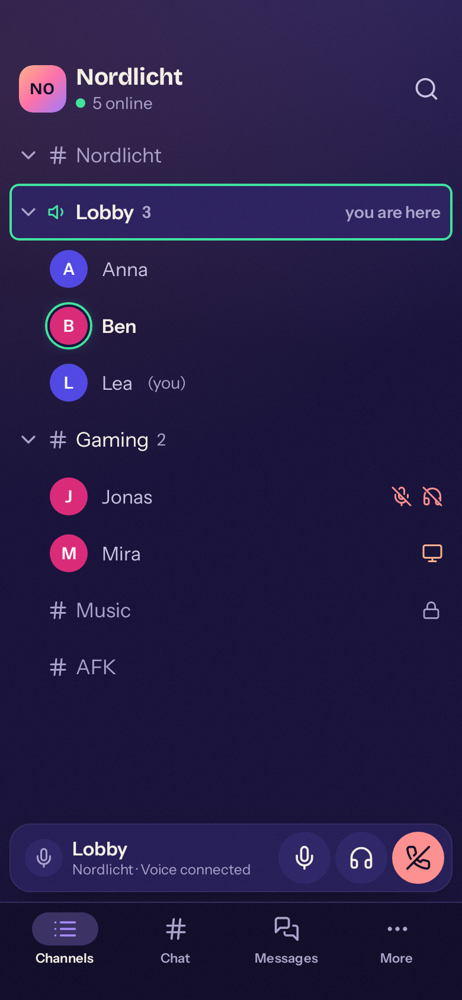
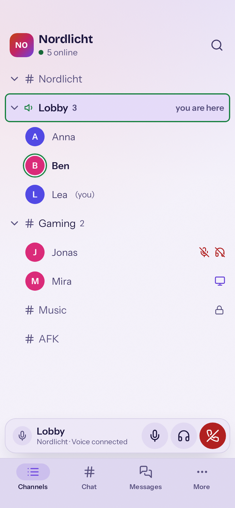
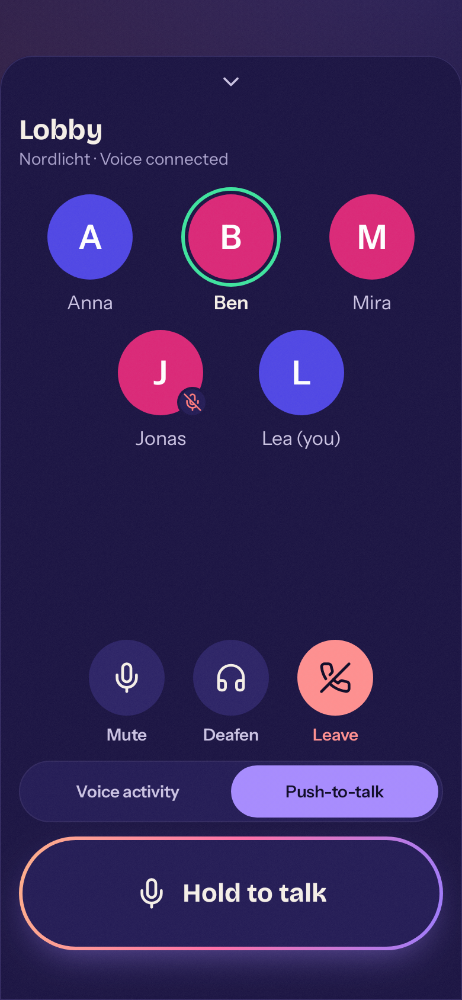
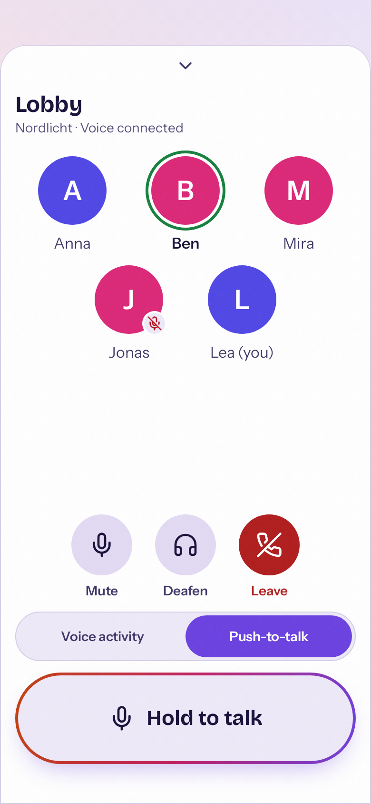
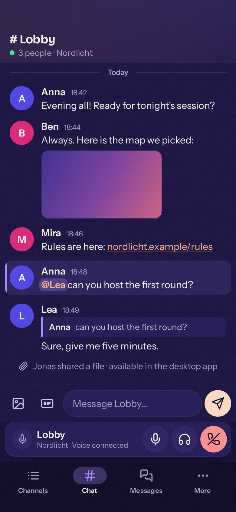
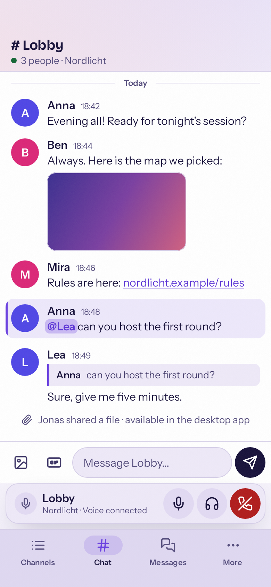
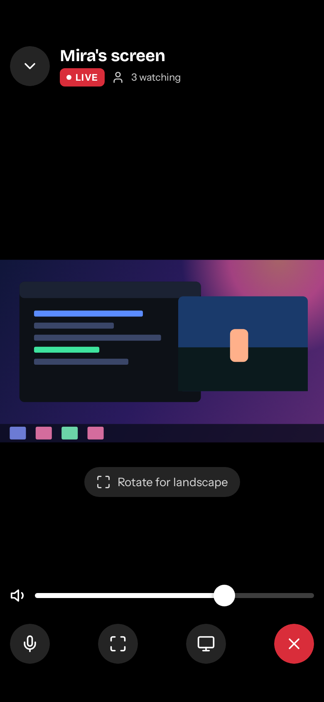
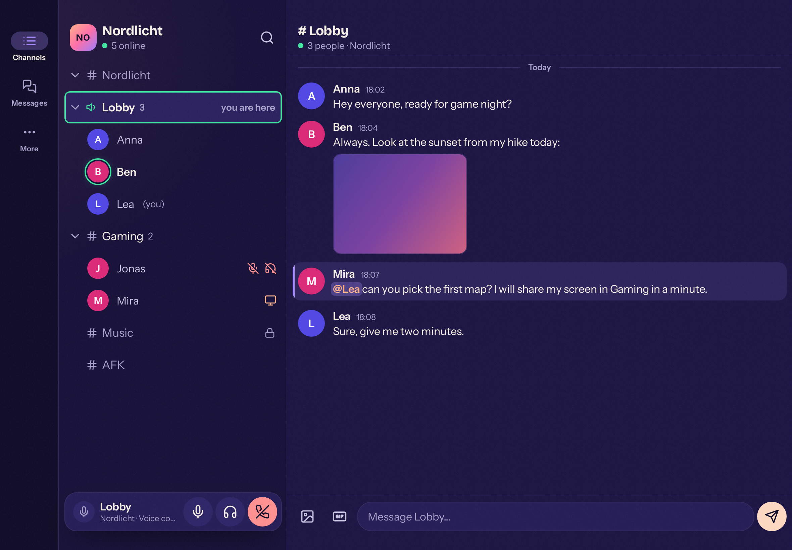
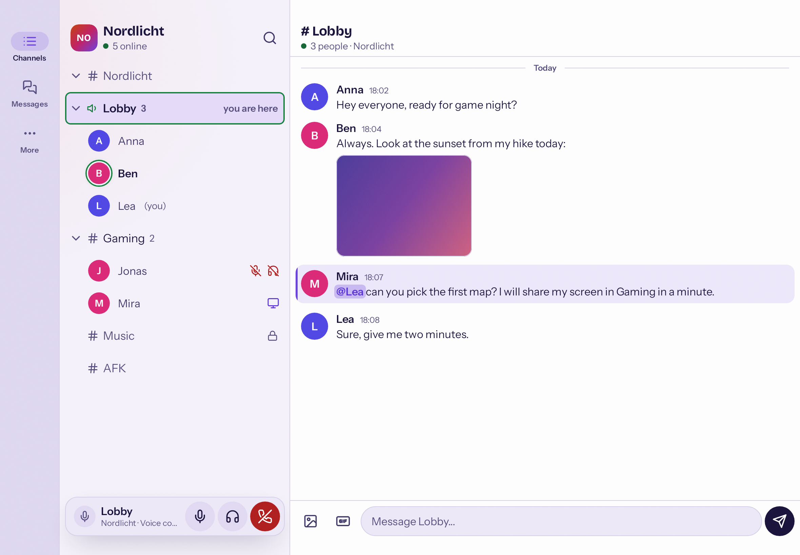

# Mumcord mobile

Voice chat for Android and iPhone that speaks the Mumble protocol. It works with any standard Mumble server: nothing has to be installed or changed on the server. It is the mobile sibling of the [Mumcord desktop app](https://github.com/Mumcord/mumcord) and runs on the same Rust engine.

 
 
 
 
 

## Status

| Platform | State |
|---|---|
| Android | The first version is feature-complete. APK files will be published on the [releases page](https://github.com/Mumcord/mumcord-mobile/releases) once signed releases start. |
| iOS | In progress and paused so that Android can be finished first. See the [iOS backlog](docs/ios-backlog.md) for what is built and what is missing. |

Nothing is in an app store yet. The iOS app will come through TestFlight first.

## Features

The list describes the Android app. iOS follows it, see the [iOS backlog](docs/ios-backlog.md).

- **Servers:** a server list with the people online and the latency, add, edit and remove servers, `mumble://` links (the app asks before it connects), channel passwords, and clear warnings when a server certificate is unknown or has changed.
- **Voice:** push-to-talk or voice activation, mute and deafen, a voice bar on every tab and a full voice view, noise suppression, per-person volume, and whisper to a person or shout to a channel. Headsets are used automatically, with a loudspeaker or earpiece choice.
- **Background and calls:** voice keeps running with a locked screen, shown as a call with Mute, Deafen and Leave buttons. A phone call mutes you and restores your state afterwards. The app reconnects when the phone switches between Wi-Fi and mobile data.
- **Chat and messages:** channel chat with replies, mentions, links, images and GIFs, private conversations, message requests, blocking, and notifications for private messages and mentions.
- **Identities:** create an identity, import a `.p12` file, export a password-protected backup, or receive your identity and server list from the desktop app by scanning a QR code.
- **Streams and camera:** watch screen shares and cameras of the people in your channel (live tile, full screen, floating mini window, picture-in-picture), and share your phone camera after a private preview.
- **Profile, themes and languages:** your comment and avatar, dark, light or system theme with built-in themes and theme codes from the desktop app, and the 24 languages of the desktop app.
- **Moderation:** move people, server mute, kick and ban with the same rules as the desktop app.
- **Activity log:** who joined, moved, left or started a screen share, by day, with filters.
- **Tablet:** a two-column layout with channels and chat side by side on wide windows.
- **Accessibility:** TalkBack support, large touch areas, and layouts that follow the system font size.
- **Privacy:** see below.

## Install

**Android 12 or later** (64-bit ARM phones and tablets):

1. When signed releases start, download `mumcord-mobile-<version>-arm64.apk` and `SHA256SUMS` from the [releases page](https://github.com/Mumcord/mumcord-mobile/releases).
2. Check the download: `sha256sum --check --ignore-missing SHA256SUMS` (on a computer) must say `OK` for the APK.
3. Open the APK on the phone and allow the installation when Android asks.

**iPhone:** not available yet. It will be offered through TestFlight first.

## Privacy and security

- TLS is always on. Unknown or changed server certificates are shown to you and never accepted silently.
- Identities and other secrets are encrypted with a key in the phone's secure hardware and are excluded from backups.
- No chat, names or audio in logs.
- Crash reports are opt-in: after a crash the app shows exactly what would be sent and sends it only if you tap "Send report".
- The daily update check contacts GitHub only, and can be switched off in Settings. The app never downloads or installs an update by itself.
- Direct connections between clients (used for streams and cameras) reveal your IP address to the other person. The app asks first and explains this.

## Development

Setup, daily commands, the engine pin and the iOS build are in [docs/development.md](docs/development.md). The repository layout:

| Path | Content |
|---|---|
| `bridge/` | Rust crate `mumcord-mobile-bridge` (UniFFI) |
| `android/` | Gradle project: `app/`, `engine/`, `platform/` |
| `ios/` | XcodeGen project, SwiftUI app, platform code |
| `design/` | Theme tokens and fonts from the desktop app |
| `i18n/` | Translation conversion from the desktop files |
| `e2e/` | Emulator and simulator tests |
| `scripts/` | Setup and build scripts |
| `docs/` | Development guide, acceptance, device checklist, screenshots |

The desktop repository [Mumcord/mumcord](https://github.com/Mumcord/mumcord) owns the engine. This repository pulls it in as a library pinned to an exact reference, see `engine.lock.toml`. The specification is `specs/05-mobile-app-specification.md` in that repository.

Releases are described in [RELEASING.md](RELEASING.md), changes in [CHANGELOG.md](CHANGELOG.md).

## Testing

- [docs/acceptance.md](docs/acceptance.md) shows how each acceptance criterion is checked.
- End-to-end tests run the real app in an emulator against a local Mumble test server (`e2e/run.sh`, see "End-to-end tests" in [docs/development.md](docs/development.md)). CI runs them on every pull request.
- [docs/device-checklist.md](docs/device-checklist.md) lists what to check by hand on real phones before each release.

## Licence

AGPL-3.0, see [LICENSE](LICENSE).
